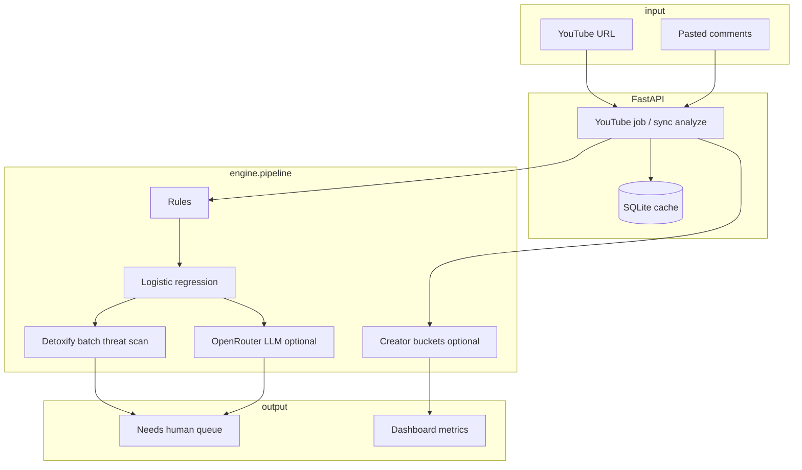
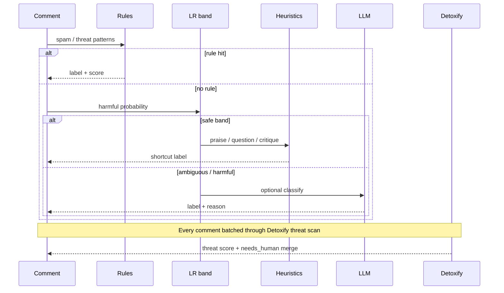

# Comment-Moderator

**Comment-Moderator** is a free-tier hybrid assistant for YouTube creators: it fetches comments, scores toxicity and threats, buckets audience feedback, and drafts replies. It **does not** auto-delete, ban, or post anything—a human always decides.

Stack: YAML rules → sklearn logistic regression → optional **Detoxify** (CPU) threat scan on every comment → optional **OpenRouter** LLM for borderline cases and creator buckets.

## Features

- Web dashboard: paste a video URL, analyze, review “needs human” items, buckets, summaries, reply drafts, insights, Q&A
- FastAPI backend with job queue for long YouTube pulls
- Chrome extension (YouTube + LinkedIn DOM scrape) — optional
- Local SQLite caches for analyses and LLM responses

## Requirements

| Component | Version |
|-----------|---------|
| Python | 3.11+ |
| Node.js | 18+ (web UI) |
| OS | Windows, macOS, or Linux |

Optional: [YouTube Data API key](https://console.cloud.google.com/), [OpenRouter](https://openrouter.ai/) key for LLM features.

## Installation (local)

```bash
git clone https://github.com/wahidpanda/Comment-Moderator.git
cd Comment-Moderator

python -m venv .venv
# Windows
.venv\Scripts\activate
# macOS/Linux
source .venv/bin/activate

pip install -e ".[dev,transformer]"

cd web && npm install && cd ..
```

### Configuration

```bash
cp .env.example .env
```

Set at minimum:

- `YOUTUBE_API_KEY` — fetch comments in the web app  
- `OPENROUTER_API_KEY` + `OPENROUTER_DEFAULT_MODEL` — if `USE_LLM=true` (free `:free` slugs recommended for demos)

Shipped LR weights live in `models/lr/v1/`. Retrain with `make train-smoke` or `make train` after `make download`.

### Run

Terminal 1 — API (port 8000):

```bash
# from repo root with venv active
python -m uvicorn api.main:app --host 127.0.0.1 --port 8000
```

Terminal 2 — Web (port 3000):

```bash
cd web && npm run dev
```

Open [http://localhost:3000](http://localhost:3000). API docs: [http://127.0.0.1:8000/docs](http://127.0.0.1:8000/docs).

First analysis may take ~1 minute while Detoxify loads weights.

## Docker

```bash
cp .env.example .env
# Edit .env with your keys

docker compose up --build
```

| Service | URL |
|---------|-----|
| Web | http://localhost:3000 |
| API | http://localhost:8000 |

Detoxify runs inside the API image (CPU PyTorch). Image build is large (~2 GB layers for torch); allow time on first `docker compose build`.

## Folder structure

```
Comment-Moderator/
├── api/              # FastAPI routes, SQLite jobs, YouTube client
├── engine/           # Moderation pipeline, rules, LR, Detoxify, LLM layers
├── research/         # Download, train, evaluation scripts
├── models/lr/v1/     # Shipped TF-IDF + logistic regression (≈60 MB)
├── tests/            # pytest suite + LR fixtures
├── web/              # Next.js dashboard
├── extension/        # Chrome MV3 (optional)
├── docs/             # Architecture, privacy, demo script, metrics
├── scripts/          # Maintenance / eval utilities (not required to run)
├── Dockerfile        # API image
├── docker-compose.yml
├── pyproject.toml
├── Makefile
└── .env.example
```

## How it works



Moderation flow per comment:



## Makefile (short)

| Target | Description |
|--------|-------------|
| `make install` | Editable Python install |
| `make download` | Civil Comments sample data |
| `make train-smoke` | Quick LR train to `models/lr/v1/` |
| `make test` | `pytest tests/` |
| `make api` | Run API module |

## Documentation

- [docs/ARCHITECTURE.md](docs/ARCHITECTURE.md) — layers and API  
- [docs/DEMO.md](docs/DEMO.md) — 5-minute demo script  
- [docs/LIMITATIONS.md](docs/LIMITATIONS.md) — honest limits  
- [docs/PRIVACY.md](docs/PRIVACY.md) — data sent to OpenRouter (`data_collection=deny`)

## Ethics

Read-only browser scraping in the extension. Respect YouTube and LinkedIn Terms of Service. No secrets in git—use `.env` locally only.

## License

MIT — see [LICENSE](LICENSE).